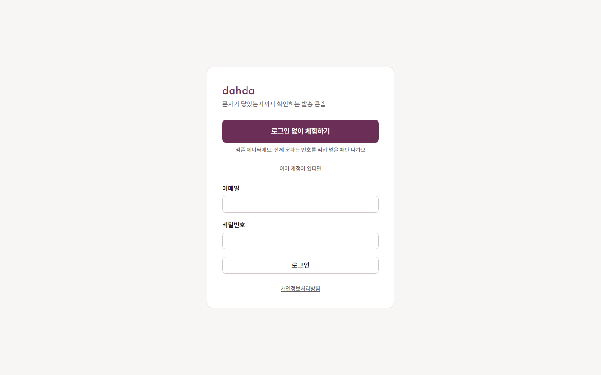
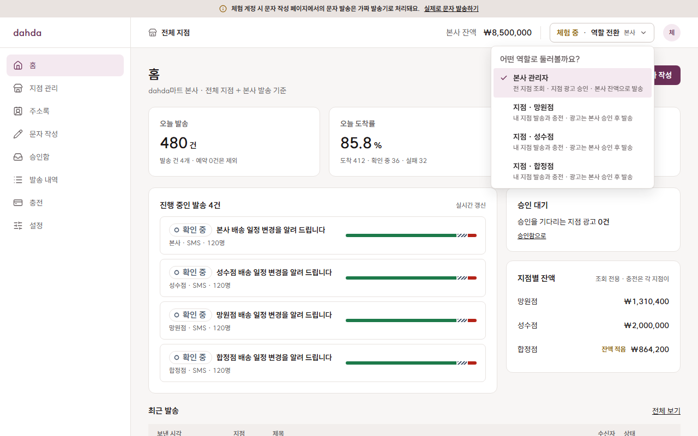
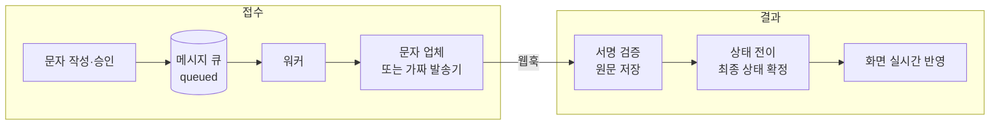

# dahda

[](https://github.com/Zzal1225/dahda/actions/workflows/ci.yml)

마트·소상공인이 손님에게 문자를 보내고, 보낸 문자가 **닿았는지**까지 확인하는 B2B 문자 발송 관리자 콘솔입니다.

이름은 "닿다"에서 왔습니다. 문자는 보낸 순간이 아니라 도착이 확인된 순간에 끝납니다. 업체가 접수한 것과 손님에게 도착한 것은 시간차를 두고 따로 오는 결과이므로, 이 둘을 구분해 정확히 보여 주는 것이 이 프로젝트의 중심입니다.

> **개발 중인 포트폴리오 프로젝트입니다.** 아래 [진행 상황](#진행-상황)에 있는 만큼만 동작합니다.
>
> **[체험해 보기](https://dahda-xi.vercel.app)**: 로그인 없이 샘플 본사로 들어가 본사·지점 역할을 바꿔 볼 수 있습니다. 샘플 데이터이고 실제 문자는 나가지 않으며, 체험 데이터는 3일 뒤 삭제됩니다.

| 로그인 | 역할 전환 |
| --- | --- |
|  |  |

## 어떤 문제를 푸나요

실무에서 문자 발송 서비스를 다루며 겪은 세 가지 문제에서 출발했습니다.

| 문제 | dahda의 방향 |
| --- | --- |
| 지점마다 계정이 따로라 본사가 전체 발송을 볼 수 없고 수신거부도 공유되지 않음 | 본사 → 지점 2단계 조직. 수신거부는 본사 공통 |
| 화면은 "접수"만 보여 주고 실패는 나중에 따로 찾아봐야 함 | 메시지별 결과를 웹훅으로 받아 실시간 반영 |
| 광고 문자 규칙을 사람이 기억해서 지켜야 함 | 표기·야간 제한을 코드로 검증하고 광고는 본사 승인 후 발송 |

## 설계에서 지키는 원칙

- **상태는 앞으로만 움직입니다.** 도착·실패가 확정된 메시지는 덮어쓰지 않습니다. 웹훅이 중복되거나 접수 기록보다 먼저 와도 결과가 흔들리지 않습니다.
- **잔액은 숫자가 아니라 거래 기록의 합계입니다.** 잔액 열을 두지 않아 모든 금액의 이유가 남고, 동시에 발송해도 잔액이 음수가 되지 않습니다.
- **권한의 최종 경계는 DB입니다.** 화면에서 숨기는 것은 편의이고, 다른 지점의 데이터는 Row Level Security가 막습니다.
- **상태와 돈은 사용자가 직접 쓰지 못합니다.** 지점이 발송 건을 직접 수정할 수 있으면 광고 승인을 건너뛸 수 있으므로, 이런 테이블은 읽기만 열고 서버만 씁니다.
- **외부 API는 서버만 부릅니다.** 문자 업체는 인터페이스 뒤에 두어 교체할 수 있고, 체험 계정과 테스트는 항상 가짜 발송기를 씁니다.

## 구조



```text
src/
  app/            화면과 라우트
  features/       기능별 코드 (auth, campaigns, billing ...)
  components/     앱 틀과 공통 UI
  server/         서버 전용: 인증, Supabase 클라이언트, 문자 업체 어댑터
  test/           통합 테스트
supabase/
  migrations/     테이블, RLS 정책, DB 함수
  seed/           10만 행 측정 데이터
e2e/              브라우저 테스트
docs/             기획서와 설계 결정 기록
```

설계 근거는 [기획서](docs/기획서.md)와 [결정 기록](docs/decisions/)에 있습니다. 먼저 읽을 코드를 고른다면 다음을 추천합니다.

- [상태 전이 규칙](src/features/campaigns/status.ts)과 [역순 도착 처리 결정](docs/decisions/2026-11-04-메시지-상태-역순-처리.md)
- [RLS 정책](supabase/migrations/20261104000200_rls.sql)과 [권한 통합 테스트](src/test/integration/rls.integration.test.ts)
- [잔액 선점 함수](supabase/migrations/20261104000300_ledger_functions.sql)와 [동시 호출 테스트](src/test/integration/ledger.integration.test.ts)

## 진행 상황

| 단계 | 내용 | 상태 |
| --- | --- | --- |
| step1 | 데이터 모델·RLS, 상태 전이, 가짜 발송기, 로그인·체험·역할 전환, 권한 가드, 지점 관리, 10만 행 시드, CI, 배포 | [완료](docs/milestones.md) |
| step2 | 발송 내역 표(10만 행 가상화, URL 필터, 행 선택) | 완료 |
| step3 | 주소록·엑셀 업로드, 문자 작성, 광고 규칙, 승인함 | 예정 |
| step4 | 발송 큐·재시도, 실제 문자 업체, 결과 웹훅, 토스 테스트 결제 | 예정 |
| step5 | 첫 화면, E2E 확대, 성능 측정 정리 | 예정 |

지금 동작하는 것은 로그인, 체험 계정, 역할 전환, 앱 틀, 지점 관리, 발송 내역 조회, 주소록, 수신거부, 엑셀 업로드, 문자 접수입니다. 실제 발송은 아직 없어 접수한 문자는 대기 상태로 남습니다.

## 기술 스택

| 영역 | 사용 |
| --- | --- |
| 표·URL 상태 | TanStack Table, TanStack Virtual, TanStack Query, nuqs |
| 엑셀 | SheetJS(Web Worker에서 실행) |
| 프레임워크 | Next.js 16 (App Router, Cache Components), React 19, TypeScript (strict) |
| 백엔드 | Supabase: Postgres + RLS, Auth, pg_cron |
| 화면 | Tailwind CSS v4, Radix UI, lucide-react |
| 폼·검증 | React Hook Form, Zod |
| 테스트 | Vitest, Testing Library, Playwright |
| CI·배포 | GitHub Actions, Vercel, Supabase |

표·서버 상태·엑셀·결제 등 이후 단계에서 쓸 라이브러리는 [기획서](docs/기획서.md#기술-스택)에 이유와 함께 정리했습니다.

## 측정

10만 행 표를 일부러 전부 렌더한 뒤, 가상화와 서버 페이지로 바꾸고 같은 조건에서 비교했습니다. 같은 PC의 헤드리스 브라우저에서 잰 값이라 실제 사용자 수치가 아니라 전후 비교용입니다. 조건과 재현 방법은 [측정 기록](docs/performance.md)에 있습니다.

| 지표 | 전부 렌더 | 가상화 + 서버 페이지 |
| --- | --- | --- |
| 접속부터 표시까지 | 12,391ms | 679ms |
| DOM 노드 | 800,086개 | 580개 |
| 메모리(JS 힙) | 179MB | 15MB |
| 스크롤 프레임 | 6fps | 60fps |

대신 빠르게 스크롤하면 자리 표시가 보이고, 멈춘 뒤 약 0.2초 뒤에 행이 나타납니다.

엑셀 2만 행 파싱을 Web Worker로 옮기면, CPU 6배 저하 조건에서 입력이 막히는 시간이 1,528ms에서 109ms로 줄었습니다. 파싱 자체는 오히려 조금 느려지며(180ms → 251ms), 개발 PC에서는 메인 스레드로도 큰 불편이 없었습니다.

## 테스트

권한처럼 틀리면 위험한 규칙은 모의 객체가 아니라 실제 DB에 대고 검사합니다.

| 종류 | 명령 | 검사 내용 |
| --- | --- | --- |
| 단위 | `npm test` | 상태 전이 전체 조합, 서명 검증, 메뉴 권한, 시드 데이터 규칙 |
| 통합 | `npm run test:integration` | 역할별 조회 범위, 쓰기 차단, DB 제약, 잔액 동시 선점 |
| 브라우저 | `npm run test:e2e` | 체험 시작, 역할 전환, 로그인·로그아웃, 화면 폭 대응 |

통합 테스트는 실제 로그인 토큰으로 REST API를 호출해 브라우저와 같은 경로를 지나고, 검사할 테이블 목록을 API에서 읽어 새 테이블도 자동으로 포함합니다. 테스트가 실제로 버그를 잡는지는 정책과 잠금을 일부러 깨뜨려 확인했습니다.

## 로컬에서 실행하기

Node.js 24 이상과 실행 중인 Docker가 필요합니다. 처음 실행할 때 Supabase 이미지를 받느라 시간이 걸리고 약 6GB의 디스크를 씁니다.

```bash
npm install
npx supabase start          # 로컬 Supabase 시작
npx supabase status         # 다음 단계에 넣을 키 확인
cp .env.example .env.local  # 값을 채운다
npm run dev                 # http://127.0.0.1:3000
```

로그인 화면의 **로그인 없이 체험하기**를 누르면 샘플 본사로 들어갑니다. 샘플 데이터이고 실제 문자는 나가지 않습니다.

10만 행 측정 데이터가 필요하면 `npm run db:seed:large`를 실행합니다.

## AI 활용

코드는 [Claude Code](https://claude.com/claude-code)가 작성했고, 커밋에 공동 작성자로 표시되어 있습니다. 처음에는 핵심 파일 3개를 직접 작성할 계획이었지만 일정상 맡겼습니다.

제가 한 일은 무엇을 만들지 정하는 기획, 도메인 규칙과 범위 결정, 결과 검토입니다. 설계 이유는 [결정 기록](docs/decisions/)에 남겼습니다.
