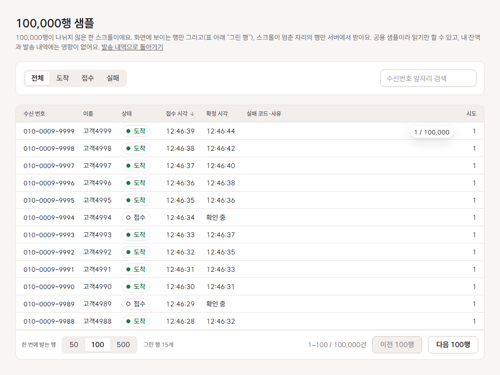
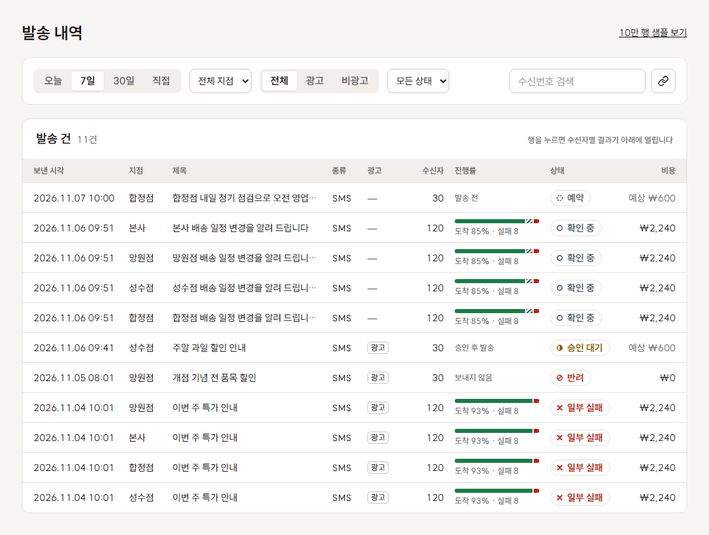
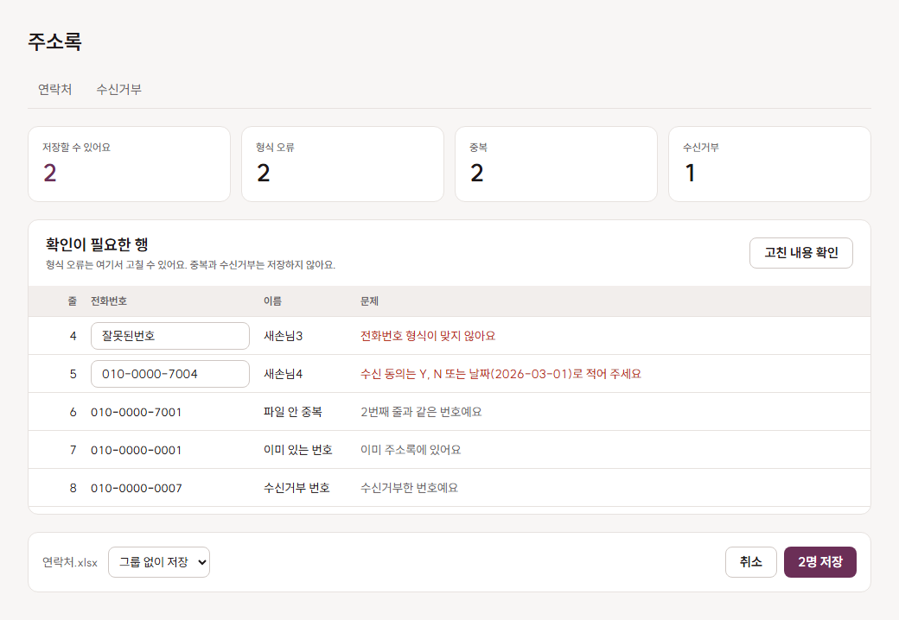
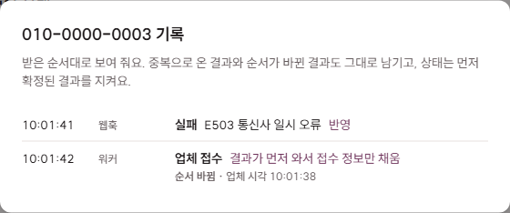

# 화면 안내: 무엇을 어디서 확인하나요

B2B 관리자 콘솔에서 중요한 여섯 가지를 체험 사이트의 어느 화면에서 볼 수 있는지 정리했습니다.

> **시작하기**: [체험 사이트](https://dahda-xi.vercel.app)에서 **로그인 없이 체험하기**를 누르면 샘플 본사(지점 3곳)로 들어갑니다.
> 체험 데이터는 3일 뒤 지워지고, 문자 작성 화면의 발송은 가짜 발송기로 처리됩니다.

| 기준 | 대표 화면 |
| --- | --- |
| [1. 데이터가 많아도 멈추지 않는 표](#1-데이터가-많아도-멈추지-않는-표) | 발송 내역 → 10만 행 샘플 보기 |
| [2. 비동기로 바뀌는 여러 상태](#2-비동기로-바뀌는-여러-상태) | 발송 내역, 기록 보기 |
| [3. 역할별 권한](#3-역할별-권한) | 상단 역할 전환 |
| [4. 검증이 많은 폼](#4-검증이-많은-폼) | 문자 작성, 엑셀 업로드 |
| [5. URL 필터와 확인 대화상자](#5-url-필터와-확인-대화상자) | 발송 내역 |
| [6. 외부 연동과 실패 처리](#6-외부-연동과-실패-처리) | 발송 내역, 충전, 실제로 문자 발송하기 |

---

## 1. 데이터가 많아도 멈추지 않는 표

10만 행을 전부 그리지 않고, 화면에 보이는 행만 그리며 필요한 부분만 서버에서 받습니다.

| 화면 | 확인할 것 |
| --- | --- |
| **발송 내역 → 10만 행 샘플 보기** | 10만 행이 나뉘지 않은 한 스크롤입니다. 끝까지 내려도 표 아래 **"그린 행"이 15개 안팎**으로 유지되고, 오른쪽에 위치 "n / 100,000"이 보입니다 |
| 발송 내역 · 수신자 표 | 스크롤이 멈춘 자리의 행만 받습니다. **한 번에 받는 행**(50/100/500)과 이전·다음 n행 이동 |
| 발송 내역 · 발송 건 목록 | 최근 200건 상한과 "기간을 좁혀 찾아보세요" 안내 |
| 주소록 → 엑셀 업로드 | 2만 행 파일을 Web Worker에서 읽어 입력이 막히지 않습니다 |
| 첫 화면 | 오늘 발송 수와 도착률을 행을 가져오지 않고 DB에서 합산합니다 |

측정 결과(전부 그리기 대비 DOM 800,086개 → 580개, 스크롤 6fps → 60fps)는 [측정 기록](performance.md)에 있습니다.

## 2. 비동기로 바뀌는 여러 상태

문자는 보낸 순간이 아니라 도착이 확인된 순간에 끝납니다. 접수와 도착은 시간차를 두고 따로 오는 결과라 화면이 둘을 구분합니다.

| 화면 | 확인할 것 |
| --- | --- |
| **발송 내역** · 발송 건 | 상태 배지(승인 대기·예약·확인 중·완료·일부 실패·반려·취소), 진행률 막대와 **"도착 n% · 실패 n"**, 발송 중이면 "실시간 갱신 중" |
| 발송 내역 · 수신자 | 상태별 건수, 결과가 오기 전 확정 시각의 **"확인 중"**, 끝나면 "결과 확정 · 더 이상 바뀌지 않아요" |
| 발송 내역 → **기록 보기** | 한 수신자에게 워커·웹훅·업체 조회가 한 일을 받은 순서대로 보여 줍니다 |
| 첫 화면 | 진행 중인 발송(실시간), 승인 대기 카드, 오늘 도착률 |
| 승인함 → 승인 | 승인하면 바로 발송되고, 발송 내역의 진행률이 새로고침 없이 차오릅니다 |
| 상단 잔액 | 발송이 끝나면 실패한 만큼 돌아온 금액이 반영됩니다 |

## 3. 역할별 권한

화면에서 숨기는 것은 편의이고, 최종 경계는 DB의 Row Level Security입니다.

| 화면 | 확인할 것 |
| --- | --- |
| **상단 역할 전환** | 본사 ↔ 지점을 바꿉니다. 화면만 바꾸는 것이 아니라 서버가 역할을 바꿉니다 |
| 왼쪽 메뉴 | 지점은 지점 관리와 승인함이 없고, 주소로 들어가도 첫 화면으로 돌아갑니다 |
| 발송 내역 | 지점은 자기 지점 건만 보고 지점 필터가 없습니다. 다른 지점 발송 건 주소로 들어와도 수신자가 보이지 않습니다 |
| 주소록 | 본사는 조회만 하고, 엑셀 내보내기와 수신거부 해제는 본사만 합니다 |
| 충전 | 충전은 계정 주인만 합니다. 본사는 지점 잔액을 조회만 합니다 |
| 모바일 폭 | 승인함만 쓸 수 있고 다른 화면은 "PC에서 열어 주세요"가 나옵니다 |

화면을 거치지 않고 지점 토큰으로 API를 바로 불러도 막히는지는 [권한 통합 테스트](../src/test/integration/rls.integration.test.ts)가 확인합니다.

## 4. 검증이 많은 폼

| 화면 | 확인할 것 |
| --- | --- |
| **문자 작성** | 바이트 계산과 SMS/LMS 자동 전환, 광고 표기와 무료거부 문구, 야간 광고 차단, 예약 시각(KST), 예상 비용, 수신거부·중복·미동의 제외 요약, 휴대폰 미리보기 |
| **주소록 → 엑셀 업로드** | 저장 가능·형식 오류·중복·수신거부로 나누고, 형식 오류는 그 자리에서 고쳐 다시 확인합니다. 수신 동의 칸(Y·N·날짜)도 검사합니다 |
| 주소록 연락처 추가·수정 | 번호 정규화, 광고 수신 동의 |
| 승인함 → 반려 | 사유 필수, 자주 쓰는 사유 버튼 |
| 지점 관리 | 빈 이름과 같은 이름을 막습니다 |

## 5. URL 필터와 확인 대화상자

| 화면 | 확인할 것 |
| --- | --- |
| **발송 내역** | 기간·지점·광고·발송 건 상태·수신자 상태·번호·정렬·선택한 발송 건·스크롤 위치가 주소에 남습니다. 새로고침하거나 **링크 복사** 버튼으로 공유해도 같은 화면이 열립니다. 적용된 필터는 칩으로 보이고 한 번에 지울 수 있습니다 |
| 10만 행 샘플 | 상태·번호 필터가 주소에 남습니다 |
| 확인 대화상자 | 문자 발송, 승인·반려, 예약 취소, 실패 건 재발송, 수신거부 해제, 연락처·그룹 삭제 |

## 6. 외부 연동과 실패 처리

외부 API(문자 발송, 결과 웹훅, 결제)는 서버만 부르고, 지연·중복·실패를 큐·재시도·멱등 키·웹훅으로 다룹니다.

| 화면 | 확인할 것 |
| --- | --- |
| 문자 작성 → 발송 | 발송은 큐에 넣고 워커가 보냅니다. 발송 버튼을 두 번 눌러도 한 건만 생깁니다 |
| **발송 내역** | "시도" 열(재시도 횟수), 실패 코드와 사유, 실패 건을 골라 재발송(원본은 두고 새 발송 건으로 잇습니다) |
| 발송 내역 → **기록 보기** | 샘플의 **010-0000-0007**은 같은 결과가 두 번 와서 두 번째를 무시했고, **010-0000-0003**은 결과가 접수 기록보다 먼저 와서 "순서 바뀜"으로 표시됩니다 |
| 상단 **실제로 문자 발송하기** | 문자 업체를 통해 본인 번호로 실제 1건을 받아 봅니다. 접수에서 도착까지 웹훅으로 바뀌는 것을 폰과 함께 볼 수 있습니다 |
| **충전** | 토스 결제창(테스트) → 서버 승인(금액을 DB와 대조, 주문번호가 멱등 키) → 서명된 웹훅 → 거래 기록 |
| 화면 밖 | 웹훅이 끝내 오지 않으면 1시간 뒤부터 업체 조회로 결과를 맞추고, 72시간이 지나면 실패로 확정해 환불합니다 |

설계 근거는 [결정 기록](decisions/)에, 처리 순서는 [웹훅 처리 코드](../src/server/webhooks/process-sms-webhook.ts)에 있습니다.
